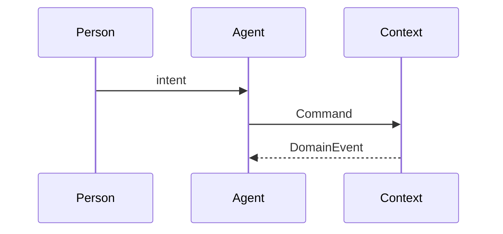

# PRD-NNNN: Title

| Field | Value |
| --- | --- |
| Status | Draft |
| Owner | |
| Reviewers | |
| Bounded context | link to `docs/domain/bounded-contexts.md#...` |
| Related ADRs | |
| Created | YYYY-MM-DD |
| Last updated | YYYY-MM-DD |

## 1. Problem

What friction in a person's life this capability removes. Evidence: observations, interviews, data. No solution language.

## 2. Goals and non-goals

### Goals

- G1:

### Non-goals

- NG1:

## 3. Personas and jobs-to-be-done

| Persona | Job to be done | Current workaround |
| --- | --- | --- |
| | | |

## 4. Domain model

### 4.1 Entities and aggregates

| Aggregate root | Entities / value objects | Invariants |
| --- | --- | --- |
| | | |

### 4.2 Commands

| Command | Issued by (person / agent / policy) | Target aggregate | Preconditions |
| --- | --- | --- | --- |
| | | | |

### 4.3 Domain events

Produced:

| Event | Emitted when | Payload (key fields) |
| --- | --- | --- |
| | | |

Consumed:

| Event | Source context | Reaction |
| --- | --- | --- |
| | | |

### 4.4 Policies and process managers

Event → command reactions, sagas, timeouts and compensations.

### 4.5 Event flow

## 5. Agent behaviour

### 5.1 Capabilities

What the agent perceives, decides and acts on. One row per action.

| Action | Tools / integrations | Autonomy level | Reversible |
| --- | --- | --- | --- |
| | | | |

Autonomy levels (see glossary): `L0 Inform`, `L1 Suggest`, `L2 Act with confirmation`, `L3 Act and notify`, `L4 Act silently`.

### 5.2 Human-in-the-loop

Confirmation points, escalation triggers, how the person overrides or revokes a delegation.

### 5.3 Guardrails

Hard limits (spend caps, recipients, time windows, data the agent may not read or share), and behaviour when a limit is hit.

### 5.4 Failure modes

| Failure | Detection | Agent response | Person-visible outcome |
| --- | --- | --- | --- |
| | | | |

## 6. User experience

Surfaces (chat, notification, voice, dashboard), key flows, notification budget.

## 7. Data, privacy and security

- Personal data processed, lawful basis, retention.
- Third-party data flows and credential handling.
- Audit trail: which events constitute the record of what the agent did and why.

## 8. Non-functional requirements

| Concern | Requirement |
| --- | --- |
| Latency | |
| Availability | |
| Cost per active user | |
| Model / provider constraints | |

## 9. Success metrics and evaluation

| Metric | Definition | Target | Source event(s) |
| --- | --- | --- | --- |
| | | | |

Agent evaluation: offline eval set, acceptance thresholds, online guardrail metrics (override rate, escalation rate, incident count).

## 10. Rollout

Phases, feature flags, cohorts, kill switch.

## 11. Open questions

- [ ] Q1:

## 12. Changelog

| Date | Author | Change |
| --- | --- | --- |
| | | Initial draft |
